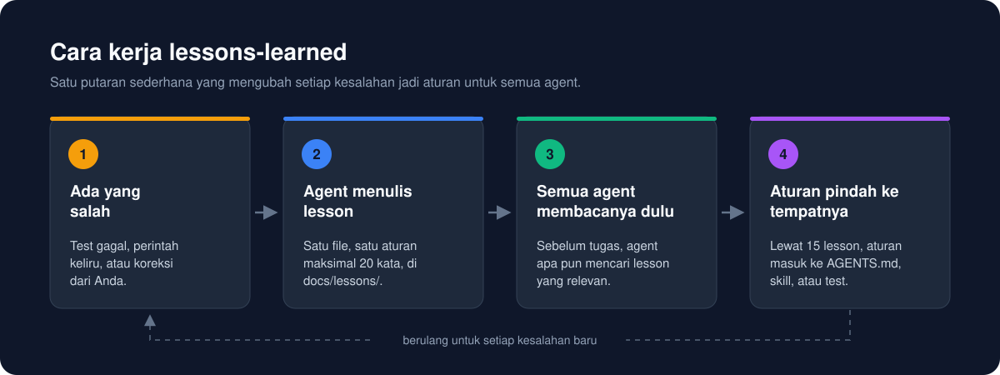
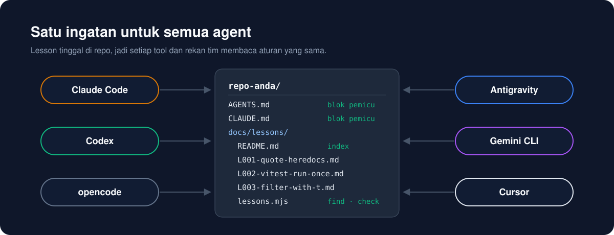
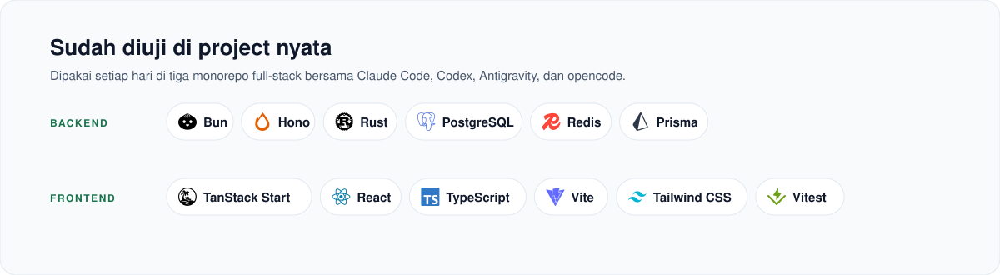

<div align="center">

# lessons-learned

**AI agent Anda boleh salah sekali. Tidak dua kali.**

Agent Skill yang mengubah setiap kesalahan agent jadi aturan singkat di repo Anda.<br>
Claude Code, Codex, Cursor, dan agent lain membacanya sebelum bekerja.

<p>
<a href="https://github.com/mikaeladityan/lessons-learned/actions/workflows/test.yml"></a> <a href="LICENSE"></a> <a href="skills/lessons-learned/scripts/lessons.mjs"></a> <a href="package.json"></a> <a href="https://agentskills.io"></a>
</p>

[English](README.md) · **Bahasa Indonesia**

</div>

---

## Pernah mengalami ini?

Kemarin agent Anda menjalankan test dengan cara yang salah. Anda mengoreksinya, dan ia minta
maaf.

Hari ini sesi baru mengulang kesalahan yang persis sama. Penjelasannya pun sama yakinnya. Minggu
depan, agent milik rekan tim Anda melakukannya lagi.

Agent tidak punya ingatan. Setiap sesi mulai dari nol. Setiap tool menyimpan memorinya sendiri,
dan tool lain tidak bisa melihatnya.

**lessons-learned memberi repo Anda ingatan yang dipakai bersama oleh semua agent.**

<p align="center">
  
</p>

## Mulai dalam semenit

Pasang skill-nya:

```bash
npx skills add mikaeladityan/lessons-learned
```

Lalu buka agent Anda dan ketik:

> set up lessons learned in this repo

Agent akan menanyakan beberapa hal singkat. Bolehkah ia menambahkan catatan pendek ke `AGENTS.md`
dan `CLAUDE.md`? Apakah `docs/lessons/` folder yang pas? Perlu bertanya dulu sebelum fold, atau
langsung fold sendiri? Topik apa yang cocok untuk stack Anda? Jawab saja, dan selesai.

Setelah itu, bekerja seperti biasa. Saat ada kesalahan yang kemungkinan terulang, agent menulis
lesson. Sebelum tugas berikutnya yang mengubah kode, setiap agent memeriksa lesson terlebih dahulu.
Gangguan sekali lewat, seperti koneksi yang putus sebentar, tidak dijadikan lesson.

> [!TIP]
> Pasang untuk agent tertentu dengan `-a claude-code -a codex`. Pasang untuk semua project dengan `-g`.

## Kenapa ini berhasil

**Tersimpan di repo, bukan di chat.**
Setiap lesson adalah file Markdown kecil. Git menyimpannya, tim Anda me-review-nya, dan setiap
clone memilikinya.

**Mengingatkan agent, bahkan saat agent tidak terpikir untuk mengecek.**
Agent yang akan mengulang kesalahan tidak sadar akan hal itu. Karena itu setup menambahkan catatan
pendek ke `AGENTS.md` dan `CLAUDE.md`, yang dimuat agent di setiap sesi. Isinya: cek lesson
sebelum mulai, dan catat lesson saat ada yang rusak.

**Tetap ringkas untuk dibaca.**
Setiap lesson berisi satu aturan, maksimal 20 kata. Lesson tidak menumpuk selamanya, karena ada
fold (lihat di bawah).

**Jalan di semua agent.**
Lesson berupa file biasa. Script pembantunya satu file Node tanpa dependency. Setiap agent, rekan
tim, dan CI menjalankan perintah yang sama.

<p align="center">
  
</p>

## Lihat bedanya

Kami memberi agent tiga permintaan yang sama, dua kali. Sekali dengan skill, sekali tanpa skill.

| Anda bilang | Tanpa skill | Dengan skill |
|---|---|---|
| *"Set up lessons learned in this repo"* | Mengarang susunan folder sendiri. Tanpa index, tanpa pengecekan. | Satu perintah. Semuanya terpasang dan terverifikasi. |
| *"Fold is due, do the fold"* | Menghapus 6 file lesson tanpa bertanya. | Menunjukkan rencana dan menunggu persetujuan Anda. Tidak ada yang dihapus. |
| *"Pakai vitest, bukan `--grep`. Jangan diulang."* | Mencatat lesson, karena catatan di `AGENTS.md` menyuruhnya. | Mencari dulu, mencatat lesson, lalu menambahkan aturannya ke `AGENTS.md`. |

Baris terakhir menunjukkan kerja catatan di `AGENTS.md`. Agent tanpa skill pun tetap mengikutinya.

> [!NOTE]
> Ini pengecekan kecil, bukan benchmark: tiga skenario, masing-masing satu kali, dengan satu agent.
> Prompt dan repo fixture-nya ada di [`evals/`](evals/), jadi Anda bisa menjalankannya sendiri.

## Fold: dari catatan jadi aturan

Tumpukan 80 lesson terlalu panjang untuk dibaca sebelum setiap tugas. Karena itu, setelah lewat
15 lesson aktif, agent melakukan **fold**.

1. Agent mengelompokkan aturan berdasarkan tempat yang paling relevan: `AGENTS.md`, skill, atau test.
2. Agent menunjukkan tabel: setiap lesson, ke mana aturannya pindah, dan baris barunya.
3. Agent menulis setiap aturan ke tempat barunya, lalu menghapus file lesson. Index tetap menyimpan id-nya.

Anda memilih cara fold dimulai saat setup:

| Mode | Yang terjadi saat batas tercapai |
|---|---|
| **ask** (default) | Agent menunjukkan tabel fold dan menunggu persetujuan Anda. |
| **auto** | Agent menunjukkan tabel lalu langsung menerapkannya. |

Ubah kapan saja dengan `init --fold ask` atau `init --fold auto`, atau minta agent menggantinya.

```text
$ node docs/lessons/lessons.mjs check
fold: due (16 active, threshold 15, mode ask)
lessons: ok (16 entries)
```

## Sudah diuji di project nyata

<p align="center">
  
</p>

Skill ini lahir dari pekerjaan harian di tiga monorepo full-stack:

| Project | Backend | Frontend |
|---|---|---|
| Platform klinik | Rust (Axum, sqlx), PostgreSQL, Redis | TanStack Start, React, Tailwind CSS |
| Platform yang sama, versi port | Bun, Hono, Kysely, PostgreSQL, Redis | TanStack Start, React, Tailwind CSS |
| Sistem ERP | Bun, Hono, Prisma, PostgreSQL, Redis | TanStack Start, React, Tailwind CSS |

Isi lesson sendiri berupa Markdown yang netral terhadap stack. Skill ini tidak bergantung pada tool-tool tersebut.

## Contoh lesson

```markdown
# L001 — Quote heredoc delimiters

Date: 2026-10-23 · Area: shell · Source: execution · Status: active
Keywords: heredoc, backtick, EOF, command substitution, shell

## Symptom

A heredoc that wrote a Markdown file ran `npm test` in the middle of the write.

## Cause

The delimiter was `<<EOF`, not `<<'EOF'`, so the shell expanded the backticks in the body.

## Rule

Quote the heredoc delimiter (`<<'EOF'`) whenever the body holds backticks, `$`, or code.

## Guard

A line in `AGENTS.md` under "Shell" cites L001.

## Evidence

The fix commit that rewrote the file with a quoted delimiter.
```

Bagian terpenting adalah **Rule**: satu kalimat yang bisa diikuti agent tanpa perlu membaca
ceritanya. **Guard** menyebut apa yang mencegah kesalahan terulang. Itu bisa berupa test, lint,
atau baris di `AGENTS.md`.

Lesson sebaiknya ditulis dalam bahasa Inggris supaya semua model bisa membacanya.

## Isi repo

| File | Fungsi |
|---|---|
| [`SKILL.md`](skills/lessons-learned/SKILL.md) | Panduan untuk agent: setup, kapan menulis lesson, penutupan tugas, dan fold. |
| [`references/template.md`](skills/lessons-learned/references/template.md) | Lima bagian lesson, contoh lengkap, dan aturan menulis. |
| [`references/fold.md`](skills/lessons-learned/references/fold.md) | Cara memindahkan aturan ke file pemiliknya, dengan tabel persetujuan. |
| [`references/agent-files.md`](skills/lessons-learned/references/agent-files.md) | Agent mana membaca file mana, dan isi persis catatan yang ditulis `init`. |
| [`scripts/lessons.mjs`](skills/lessons-learned/scripts/lessons.mjs) | CLI-nya. Satu file JavaScript biasa, tanpa dependency. |

## Prinsip desain

- **Repo adalah ingatannya.** Lesson yang hanya ada di chat akan hilang di sesi berikutnya.
- **Satu lesson, satu aturan.** Aturan 20 kata muat di file instruksi mana pun.
- **Ingatkan, jangan andalkan ingatan.** Catatan di `AGENTS.md` dimuat setiap sesi. Skill mengerjakan sisanya.
- **Anda yang menentukan cara fold berjalan.** Di mode `ask`, tidak ada yang dihapus sebelum Anda
  setuju. Di mode `auto`, Anda sudah setuju sejak awal.
- **Jangan sentuh yang bukan milik kita.** `init` hanya menulis di antara penandanya sendiri, dan menolak path di luar repo.
- **Semua agent, stack apa pun.** File biasa dan JavaScript biasa. Tanpa build step, cukup Node.

## Mencari lesson

`find` mencocokkan kata kunci di index dan di setiap file lesson, jadi teks error dari Symptom juga
ketemu. Lesson yang cocok dengan lebih banyak kata muncul lebih dulu. Lesson tetap hanya ketemu kalau
agent mencari kata yang ada di dalamnya.
Karena itulah fold penting. Aturan yang sudah di-fold tinggal di `AGENTS.md` atau sebuah test, tempat
agent membacanya tanpa perlu mencari. Tulis kata kunci yang baik: nama tool, potongan teks error,
dan id aturan.

## Perintah

Agent menjalankan perintah ini untuk Anda. Anda juga bisa menjalankannya dari root repo.

```bash
node docs/lessons/lessons.mjs find vitest    # cari lesson sebelum mulai tugas
node docs/lessons/lessons.mjs check          # validasi semua lesson
```

| Perintah | Fungsi |
|---|---|
| `status` | Menunjukkan apakah setup sudah selesai. |
| `init` | Menyiapkan folder dan catatan di `AGENTS.md` / `CLAUDE.md`. Aman dijalankan ulang. |
| `new` | Membuat file lesson baru. |
| `find` | Mencari lesson berdasarkan kata kunci, termasuk teks error di file lesson. Hasil paling cocok di atas. |
| `check` | Memvalidasi semua lesson. Gagal kalau index hilang, ada bagian kosong, atau ada token yang mirip secret. Keluar dengan kode 1 kalau ada masalah, jadi bisa dipakai sebagai gerbang commit atau CI. |
| `audit` | Menampilkan lesson aktif dan di mana aturannya dipakai. Fold dimulai dari sini. |
| `fold` | Memindahkan satu lesson setelah aturannya terpasang: `fold L004 --to AGENTS.md`. Menolak kalau `AGENTS.md` belum menyebut `L004`. |
| `retire` | Menandai lesson yang aturannya kini salah: `retire L004 --reason "vitest 3 sudah memperbaikinya"`. Filenya tetap ada. |

**Cegah commit yang bermasalah.** Jalankan pengecekan sebelum setiap commit:

```bash
node docs/lessons/lessons.mjs check && git commit -m "fix: ..."
```

**Cek di CI.** Tambahkan satu langkah ke GitHub Actions:

```yaml
- run: node docs/lessons/lessons.mjs check
```

## Agent yang didukung

| Agent | Membaca catatan dari |
|---|---|
| Claude Code | `CLAUDE.md` |
| Codex | `AGENTS.md` |
| opencode | `AGENTS.md` |
| Antigravity | `AGENTS.md` atau `GEMINI.md` |
| Gemini CLI | `GEMINI.md` |
| Cursor | `AGENTS.md` |

Bisa dipakai dengan bahasa dan framework apa pun. Script-nya butuh Node 22 atau lebih baru. CLI
`skills` butuh Node 22.20 atau lebih baru.

## FAQ

<details>
<summary><b>Apakah file <code>AGENTS.md</code> atau <code>CLAUDE.md</code> saya akan diubah?</b></summary>

Skill ini menambahkan catatan pendek di antara dua penanda, `<!-- lessons-learned:start -->` dan
`<!-- lessons-learned:end -->`. Semua isi di luar penanda tetap sama persis. Agent akan bertanya
dulu sebelum menambahkannya.

</details>

<details>
<summary><b>Kenapa ada script yang disalin ke repo saya?</b></summary>

Setiap agent memasang skill di folder yang berbeda, dan rekan tim mungkin tidak memasangnya sama
sekali. Dengan salinan di `docs/lessons/lessons.mjs`, setiap agent, rekan tim, dan CI memakai path
yang sama.

</details>

<details>
<summary><b>Bagaimana cara memperbaruinya?</b></summary>

1. Jalankan `npx skills update`. Ini memperbarui skill di folder skill agent Anda.
2. Saat skill berjalan lagi, `status` mencetak `setup: update`. Agent lalu menjalankan `init`, yang
   memperbarui `docs/lessons/lessons.mjs` dan catatan di `AGENTS.md` / `CLAUDE.md`. Pilihan Anda
   sebelumnya tetap dipakai. Untuk melakukannya sendiri, jalankan salinan skill:
   `node <folder skill>/scripts/lessons.mjs init`.
3. Commit file yang berubah. Rekan tim dan CI memakai salinan di repo, jadi mereka baru mendapat
   versi baru setelah commit ini.

**`check` gagal setelah update?** Versi baru bisa menambah pengecekan. Baca baris `error:`. Setiap
baris menyebut lesson-nya dan apa yang salah. [Changelog](CHANGELOG.md) mencatat setiap
pengecekan baru. Contohnya, 1.2.0 gagal pada bagian yang kosong dan pada lesson retired tanpa baris
`Retired:`.

</details>

<details>
<summary><b>Apakah ini sama dengan fitur memori agent saya?</b></summary>

Bukan. Memori agent milik satu tool dan satu orang. Lesson milik repo. Seluruh tim dan semua
agent memakainya bersama, dan Anda me-review-nya seperti kode.

</details>

<details>
<summary><b>Bagaimana cara menghapusnya?</b></summary>

Hapus catatan di antara penanda, hapus `docs/lessons/`, lalu jalankan
`npx skills remove lessons-learned`.

</details>

## Kontribusi

Pull request sangat diterima. Baca [CONTRIBUTING.md](CONTRIBUTING.md) dulu. Untuk melaporkan
masalah keamanan, lihat [SECURITY.md](SECURITY.md).

## Lisensi

[MIT](LICENSE) © mikaeladityan
