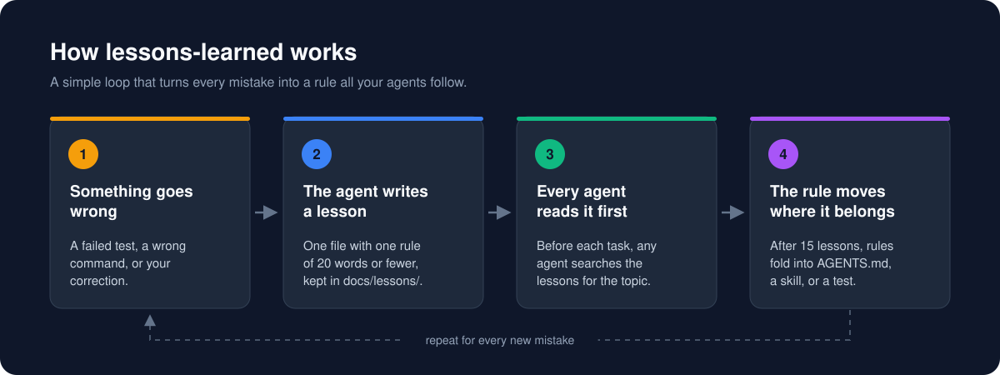
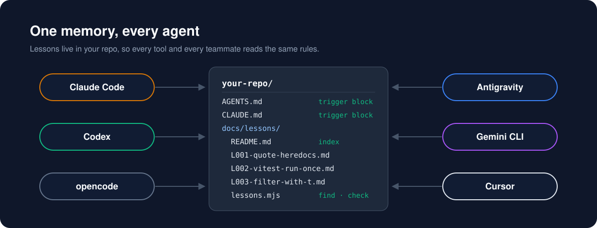
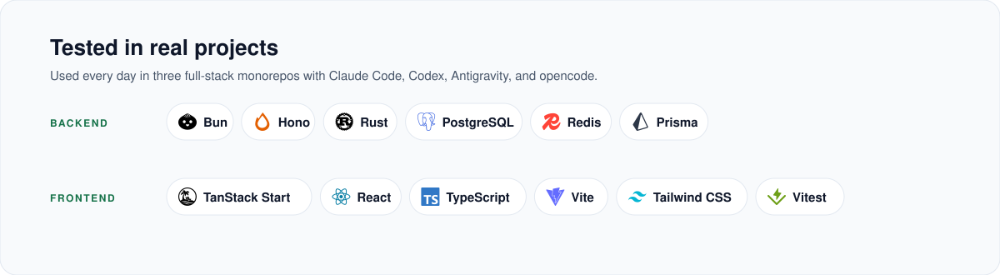

<div align="center">

# lessons-learned

**Your AI agent makes a mistake once. Never twice.**

An Agent Skill that turns each agent mistake into a short rule in your repo.<br>
Claude Code, Codex, Cursor, and every other agent read it before they work.

<p>
<a href="https://github.com/mikaeladityan/lessons-learned/actions/workflows/test.yml"></a> <a href="LICENSE"></a> <a href="skills/lessons-learned/scripts/lessons.mjs"></a> <a href="package.json"></a> <a href="https://agentskills.io"></a>
</p>

**English** · [Bahasa Indonesia](README.id.md)

</div>

---

## Sound familiar?

Yesterday your agent ran the tests the wrong way. You corrected it, and it apologized.

Today a fresh session makes the exact same mistake. It even gives the same confident explanation.
Then a teammate's agent does it again next week.

Agents don't remember. Every session starts from zero. Each tool keeps its own private memory,
and no other tool can see it.

**lessons-learned gives your repo a memory that every agent shares.**

<p align="center">
  
</p>

## Get started in a minute

Install the skill:

```bash
npx skills add mikaeladityan/lessons-learned
```

Then open your agent and say:

> set up lessons learned in this repo

Your agent asks a few quick questions. Can it add a short note to `AGENTS.md` and `CLAUDE.md`?
Is `docs/lessons/` a good folder? Should it ask before a fold, or fold on its own? Which topics fit
your stack? Answer them, and you are done.

From then on, just work. When something goes wrong, the agent writes a lesson. Before the next
task, every agent checks the lessons first.

> [!TIP]
> Install for specific agents with `-a claude-code -a codex`. Install for all your projects with `-g`.

## Why it works

**It lives in your repo, not in a chat.**
Every lesson is a small Markdown file. Git keeps it, your team reviews it, and every clone has it.

**It reminds agents even when they don't think to look.**
An agent that is about to repeat a mistake doesn't know it. So setup adds a short note to
`AGENTS.md` and `CLAUDE.md`, which agents load in every session. The note says: check the lessons
before you start, and record a lesson when something breaks.

**It stays short enough to read.**
Each lesson holds one rule of 20 words or fewer. Lessons don't pile up forever, thanks to the fold
(see below).

**It works with every agent.**
The lessons are plain files. The helper script is one Node file with zero dependencies. Every
agent, every teammate, and your CI run the same command.

<p align="center">
  
</p>

## See the difference

We gave an agent the same three requests twice, once with the skill and once without it.

| You say | Without the skill | With the skill |
|---|---|---|
| *"Set up lessons learned in this repo"* | Invents its own folder layout. No index, no checks. | One command. Everything is in place and verified. |
| *"Fold is due, do the fold"* | Deletes 6 lesson files without asking. | Shows a plan and waits for your approval. Deletes nothing. |
| *"Use vitest, not `--grep`. Never again."* | Records the lesson, because the note in `AGENTS.md` told it to. | Searches first, records the lesson, and adds the rule to `AGENTS.md`. |

The last row shows the note in `AGENTS.md` at work. An agent without the skill still follows it.

## The fold: from notes to rules

A pile of 80 lessons is too long to read before every task. So when you pass 15 active lessons,
the agent **folds** them.

1. It groups the rules by where they matter: `AGENTS.md`, a skill, or a test.
2. It shows you a table: each lesson, where its rule goes, and the exact new line.
3. It writes each rule into its new home and deletes the lesson file. The index keeps the id.

You choose how the fold starts at setup:

| Mode | What happens when the limit is reached |
|---|---|
| **ask** (default) | The agent shows the fold table and waits for your OK. |
| **auto** | The agent shows the table and applies it right away. |

Change it any time with `init --fold ask` or `init --fold auto`, or ask your agent to switch.

```text
$ node docs/lessons/lessons.mjs check
fold: due (16 active, threshold 15, mode ask)
lessons: ok (16 entries)
```

## Tested in real projects

<p align="center">
  
</p>

The skill came out of daily work on three full-stack monorepos:

| Project | Backend | Frontend |
|---|---|---|
| A clinic platform | Rust (Axum, sqlx), PostgreSQL, Redis | TanStack Start, React, Tailwind CSS |
| The same platform, ported | Bun, Hono, Kysely, PostgreSQL, Redis | TanStack Start, React, Tailwind CSS |
| An ERP system | Bun, Hono, Prisma, PostgreSQL, Redis | TanStack Start, React, Tailwind CSS |

The lessons themselves are stack-neutral Markdown. Nothing in the skill depends on these tools.

## What a lesson looks like

```markdown
# L001 — Quote heredoc delimiters

Date: 2026-10-23 · Area: shell · Source: execution · Status: active
Keywords: heredoc, backtick, EOF, command substitution, shell

## Symptom

A heredoc that wrote a Markdown file ran `npm test` in the middle of the write.

## Cause

The delimiter was `<<EOF`, not `<<'EOF'`, so the shell expanded the backticks in the body.

## Rule

Quote the heredoc delimiter (`<<'EOF'`) whenever the body holds backticks, `$`, or code.

## Guard

A line in `AGENTS.md` under "Shell" cites L001.

## Evidence

The fix commit that rewrote the file with a quoted delimiter.
```

The **Rule** is the part that matters. It is one sentence an agent can follow without the story.
The **Guard** says what stops a repeat. That can be a test, a lint, or a line in `AGENTS.md`.

## What's inside

| File | Purpose |
|---|---|
| [`SKILL.md`](skills/lessons-learned/SKILL.md) | The agent's guide: setup, when to write a lesson, close-out, and fold. |
| [`references/template.md`](skills/lessons-learned/references/template.md) | The five sections of a lesson, a worked example, and writing rules. |
| [`references/fold.md`](skills/lessons-learned/references/fold.md) | How to move rules into their owner files, with an approval table. |
| [`references/agent-files.md`](skills/lessons-learned/references/agent-files.md) | Which agent reads which file, and the exact note `init` writes. |
| [`scripts/lessons.mjs`](skills/lessons-learned/scripts/lessons.mjs) | The CLI. One plain JavaScript file, zero dependencies. |

## Design principles

- **The repo is the memory.** A lesson that lives only in a chat is gone next session.
- **One lesson, one rule.** A rule of 20 words fits in any instruction file.
- **Remind, don't rely on recall.** The note in `AGENTS.md` loads every session. The skill does the rest.
- **You decide how a fold runs.** In `ask` mode, nothing is deleted until you approve. In `auto`
  mode, you agreed in advance.
- **Never touch what isn't ours.** `init` writes only between its own markers. It refuses paths outside the repo.
- **Every agent, any stack.** Plain files and plain JavaScript. No build step and no runtime besides Node.

## Commands

Your agent runs these for you. You can run them from the repo root too.

```bash
node docs/lessons/lessons.mjs find vitest    # search lessons before a task
node docs/lessons/lessons.mjs check          # validate every lesson
```

| Command | What it does |
|---|---|
| `status` | Shows whether setup is done. |
| `init` | Sets up the folder and the note in `AGENTS.md` / `CLAUDE.md`. You can run it again safely. |
| `new` | Creates a new lesson file. |
| `find` | Searches lessons by keyword. |
| `check` | Validates every lesson. It exits with code 1 on a problem, so it works as a commit or CI gate. |
| `audit` | Lists active lessons and where each rule is used. The fold starts here. |
| `fold` | Moves one lesson after its rule is in place: `fold L004 --to AGENTS.md`. It refuses if `AGENTS.md` does not cite `L004`. |

**Block bad commits.** Run the check before each commit:

```bash
node docs/lessons/lessons.mjs check && git commit -m "fix: ..."
```

**Check in CI.** Add one step to GitHub Actions:

```yaml
- run: node docs/lessons/lessons.mjs check
```

## Works with your agents

| Agent | Reads the note from |
|---|---|
| Claude Code | `CLAUDE.md` |
| Codex | `AGENTS.md` |
| opencode | `AGENTS.md` |
| Antigravity | `AGENTS.md` or `GEMINI.md` |
| Gemini CLI | `GEMINI.md` |
| Cursor | `AGENTS.md` |

It works with any language and any framework. The script needs Node 22 or later. The `skills` CLI
needs Node 22.20 or later.

## FAQ

<details>
<summary><b>Will it touch my existing <code>AGENTS.md</code> or <code>CLAUDE.md</code>?</b></summary>

It adds a short note between two markers, `<!-- lessons-learned:start -->` and
`<!-- lessons-learned:end -->`. Everything outside the markers stays the same, byte for byte. It
asks you first.

</details>

<details>
<summary><b>Why does it copy a script into my repo?</b></summary>

Each agent installs skills in a different folder, and a teammate may not have the skill at all.
With a copy at `docs/lessons/lessons.mjs`, every agent, every teammate, and CI run the same path.

</details>

<details>
<summary><b>How do I update it?</b></summary>

Run `npx skills update`. The next time your agent runs `status`, it sees the old copy and updates
it. It keeps your earlier choices.

</details>

<details>
<summary><b>Is this the same as my agent's memory feature?</b></summary>

No. Agent memory belongs to one tool and one person. Lessons belong to the repo. Your whole team
and every agent share them, and you review them like code.

</details>

<details>
<summary><b>How do I remove it?</b></summary>

Delete the note between the markers, delete `docs/lessons/`, and run
`npx skills remove lessons-learned`.

</details>

## Contributing

Pull requests are welcome. Read [CONTRIBUTING.md](CONTRIBUTING.md) first. To report a security
problem, see [SECURITY.md](SECURITY.md).

## License

[MIT](LICENSE) © mikaeladityan
